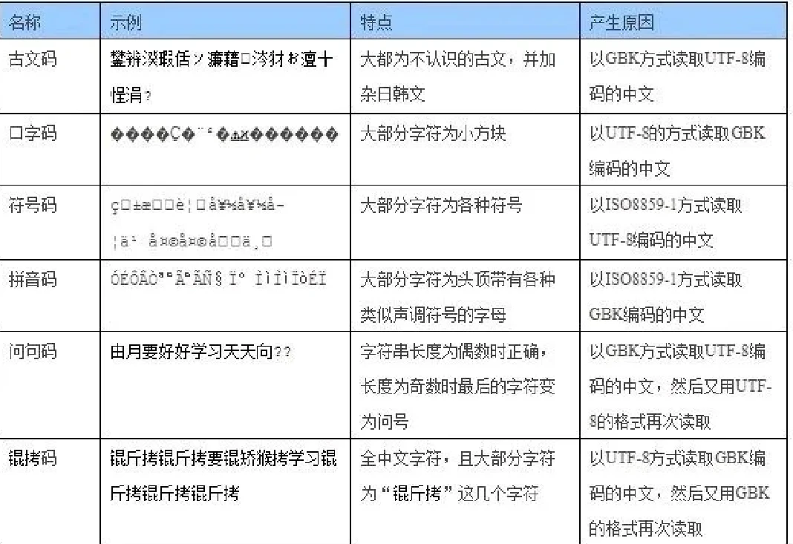

# 中文乱码
**什么是编码**
- 字符：指类字形单位或符号，包括字母、数字、运算符号、标点符号和其他符号，以及一些功能性符号。
- 字符集：字符组成的集合。
- 字符编码：是把字符集中的字符编码为指定集合中某一对象（例如：比特模式、自然数序列、8位组或者电脉冲），以便文本在计算机中存储和通过通信网络的传递。

**为什么会乱码**（推荐第一个链接）
在不同的字符集与编码方式下，同一段二进制数所代表的字符并不相同，从而导致乱码现象。
- [ 锟斤拷�⊠是怎样炼成的——中文显示“⼊”门指南 ](https://www.bilibili.com/video/BV1cB4y177QR/?share_source=copy_web&vd_source=72c0a029f1b629b881f0e02b91fc2df8)
- [非常详细的字符编码讲解](https://www.bilibili.com/video/BV1gZ4y1x7p7/?share_source=copy_web&vd_source=72c0a029f1b629b881f0e02b91fc2df8)

**解决编码问题**
- 设置默认编码，统一不同平台的编码解码即可

**常见的编码方式介绍**
- ASCII：🇺🇸用1个byte（8bit）做出的字符集，有2的八次方个码位，却只使用了一半
- GB2312：🇨🇳为了兼容汉字，设计的字符集。为了增加码位而用两个byte表示一个字符
- GBK：为适应繁体等，在GB2312基础上的扩容集合
- UNIcode：适应主流文字而做出的字符集，依据书写系统划分字符。  
（UNICODE还具有私用区，可自定义使用。UNICODE具有包括UTF-8，UTF-16，UTF-32多种编码方式，最为常用的是UTF-8）

**常见的乱码对应的编码解码判断**
- 

