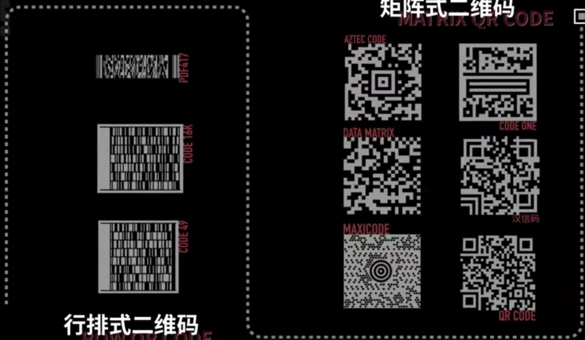
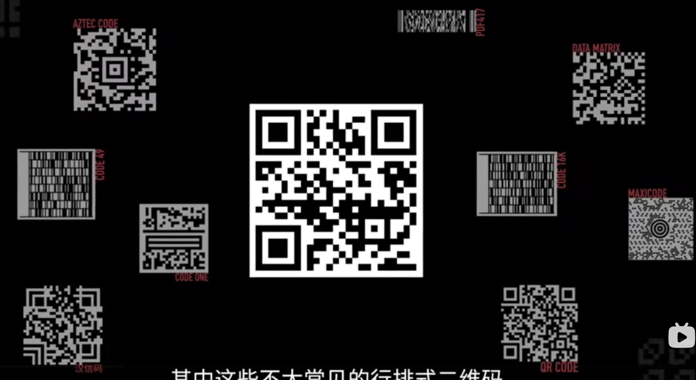
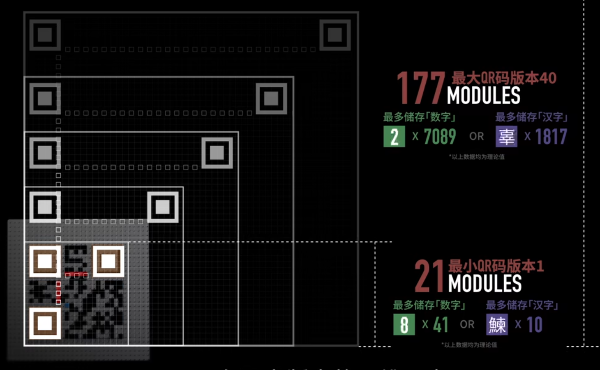
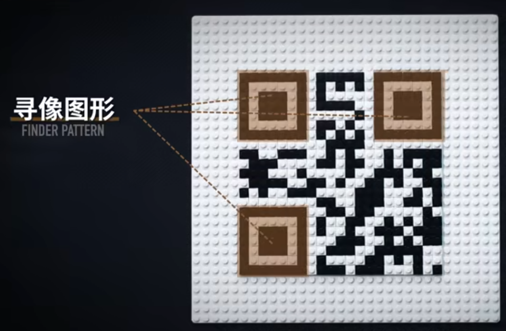
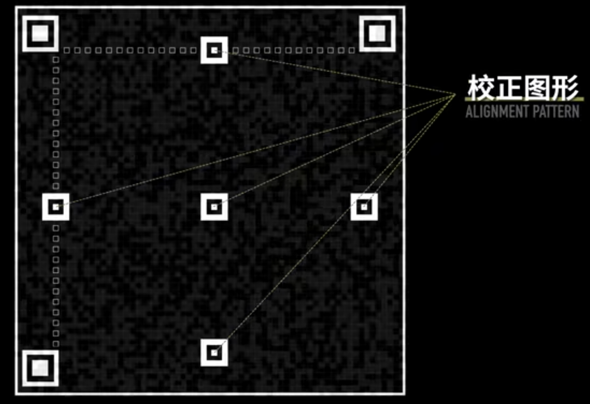

# QR

## QR讲解链接(推荐第一个)
 [用肉眼识别二维码，总共分几步](https://www.bilibili.com/video/BV1KZ4y1p72k/?share_source=copy_web&vd_source=72c0a029f1b629b881f0e02b91fc2df8)    
 [我在围棋板上做了个二维码来探索其背后的工作原理](https://www.bilibili.com/video/BV16gk5YDEB7/?share_source=copy_web&vd_source=72c0a029f1b629b881f0e02b91fc2df8)

## 其他2D_code
QR,全称quick Response，只是二维码的一种。

## QR版本
- Version 1：21×21
- Version 40：177×177
- 每增加一个 Version，长宽 +4 Module

## QR固定结构
- **寻像图形（Finder Pattern）**
  - 作用:定位、定向  

- **校正图形（Alignment Pattern）**
  - 校正几何变形  
  - V1 无，V2+ 有  

- **分隔符（Separator）**
  - 分隔寻像图形
- **时序图形（Timing Pattern）**
  - 黑白交替
  - 确定 Module 网格
- **格式信息（Format Information）**
  - 纠错等级
  - Mask
- **版本信息（Version Information）**
  - V7+ 存在

## QR信息部分
- **数据编码**
  - Numeric
  - Alphanumeric
  - Byte
  - Kanji
- **纠错**
  - Reed-Solomon
  - L：7%
  - M：15%
  - Q：25%
  - H：30%

## 掩码

- **作用**
  - 优化黑白分布
  - 提高识别可靠性
  - 非加密
- **类型**
  - 主要有8种掩码：Mask 0 ~ Mask 7（自己去查）
- **作用方法**
  - 根据规则判断 Module 是否反转
- **选择**
  - 8种分别评分
  - 选择 Penalty Score 最低者